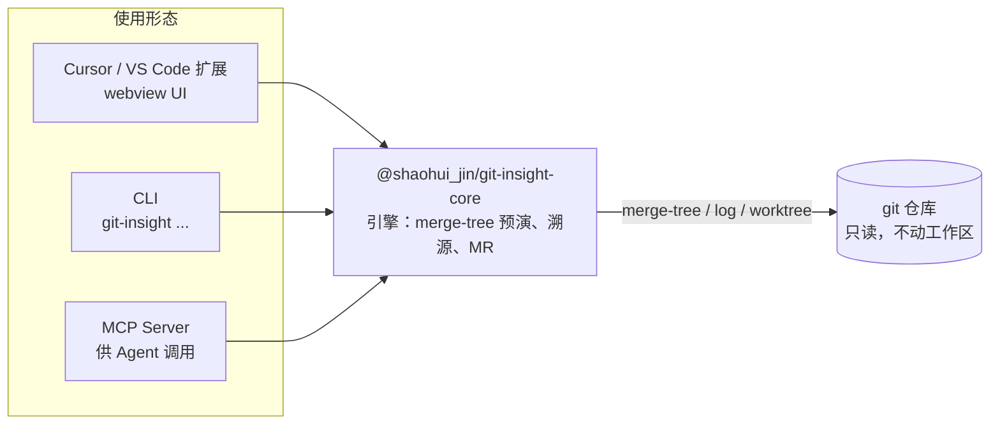

# Git Insight

Git 分支溯源、合并冲突预演，以及 Cursor/VS Code 扩展内的一键解决冲突与申请 MR。

核心是一句话：**用 `git merge-tree` 在对象库里把合并算一遍，不碰工作区**。
所以「合不合得进去」这个问题可以随便问、反复问，不用先切分支也不用怕留下烂摊子。

## 它解决什么问题

一个分支要合进主干，团队里常见的问题是「合了会不会炸」。用传统方式验证要切分支、真合一次、冲突了再回滚 —— 代价太高，于是没人愿意提前验证，问题都堆到合并那一刻。

Git Insight 把这件事变成只读操作：在对象库里模拟合并，直接告诉你

- 哪些文件会冲突
- 冲突的具体内容是什么
- 每一块冲突是谁在哪个 commit 改的

而且不切换分支、不动工作区、不留任何痕迹。

## 核心能力

- **合并预演** —— 单对分支，给冲突文件、冲突正文和逐块溯源（谁在哪个 commit 改的）
- **合并矩阵** —— 多条分支 × 多个目标，一屏看清谁合得进去
- **合入顺序建议** —— 多条分支要进同一个目标时，推演最省事的次序
- **一键解决并推送** —— 在独立 worktree 里落盘，主工作区全程不动
- **冲突预警常驻**（默认关闭）—— 后台盯着，只在变糟时提醒
- **申请 MR / PR** —— GitHub / GitLab，走本机 CLI 或 Token

安装 **Git Insight** 扩展后，还可在任意仓库用 Agent Skill：`/git-branch-insight` + 需求（扩展启动时会同步到 `~/.cursor/skills/`）。

## 界面在哪

UI 是 Cursor / VS Code 扩展的 webview，**需要安装扩展才能看到**（它不是独立网页，浏览器打开无法获取仓库数据）：

```bash
pnpm install
pnpm package:vsix
cursor --install-extension git-insight.vsix --force
```

装完 Reload，打开任意 Git 仓库，侧边栏会多出 Git Insight 面板，分三步走：

1. **Git 配置** —— 选择 MR 方式（本机 gh/glab、下载 CLI、Token、或仅打开浏览器）
2. **分支图** —— 看分支拓扑，点分支 tip 看它到目标的链路
3. **合并预演** —— 选线上目标 + 我的分支，完成冲突选边（支持 AI 辅助）

## CLI

不装扩展也能用，全部能力都在 CLI 里：

```bash
git-insight --help
```

```text
Usage (read-only):
  git-insight graph [--cwd <path>] [--max <n>] [--into <branch>] [--from <branch>] [--no-fetch]
  git-insight fetch [--cwd <path>] [--remote <name>]
  git-insight preview-merge --into <线上目标> --from <我的分支> [--cwd <path>] [--no-fetch] [--pr]
  git-insight survey --into <a,b> --from <x,y,z> [--cwd] [--no-fetch] [--concurrency <n>]
  git-insight merge-order --into <线上目标> --branches <a,b,c> [--cwd] [--no-fetch]

Usage (write / MR — 需确认后由 Agent 调用):
  git-insight apply-resolve --into <线上> --from <我的> --stash <file.json> [--cwd] [--no-push]
  git-insight prepare-mr --into <线上> --from <我的> [--source <分支>] [--method cli|token] [--token <pat>] [--cwd]
  git-insight create-mr --source <源> --target <目标> [--method cli|token] [--token <pat>] [--title] [--body] [--reviewers a,b] [--cwd]
```

### 输出示例

`main` 与 `feature/payment` 改了同一个文件，预演结果：

```bash
git-insight preview-merge --into main --from feature/payment --no-fetch
```

```json
{
  "ok": true,
  "command": "preview-merge",
  "data": {
    "into": "main",
    "from": "feature/payment",
    "clean": false,
    "conflictFiles": [
      {
        "path": "app.js",
        "contentConflict": true,
        "hunks": [
          {
            "path": "app.js",
            "oursRange": [1, 1],
            "theirsRange": [1, 1],
            "oursCommits": [{ "sha": "93de477", "subject": "fix: 1.0.1" }],
            "theirsCommits": [{ "sha": "f52993c", "subject": "feat: 1.1.0" }]
          }
        ]
      }
    ]
  }
}
```

`oursCommits` / `theirsCommits` 就是逐块溯源 —— 直接告诉你这块冲突是哪两个提交撞出来的，不用再 `git log` 一层层翻。

## 架构



三种使用形态共用同一套引擎，行为一致。所有只读操作都不改工作区，
写操作（`apply-resolve` / `create-mr`）需要显式确认。

## 包

| 包 | 说明 |
| --- | --- |
| `packages/core` | 引擎 + CLI，不依赖 VS Code |
| `packages/extension` | Cursor / VS Code 扩展（含 webview） |
| `packages/mcp` | MCP server `@shaohui_jin/git-insight-mcp-server`（npm） |

## 快速命令

```bash
pnpm install
pnpm --filter @shaohui_jin/git-insight-core build
pnpm package:vsix
cursor --install-extension git-insight.vsix --force
```

扩展 ID：`jinshaohui.git-insight`。装完 Reload，Agent 输入 `/git-branch-insight` 再说需求即可。

## 文档

- [docs/guide.md](docs/guide.md) —— 主流程、各模块 git/gh/glab 指令、核心实现、Skill、指令一览
- [docs/roadmap.md](docs/roadmap.md) —— 功能清单与实现进度

## 约定

目标分支仅远程；我的分支可本地；同名分支（如 `master` ↔ `origin/master`）请自行 push / pull，不走本工具 MR。
